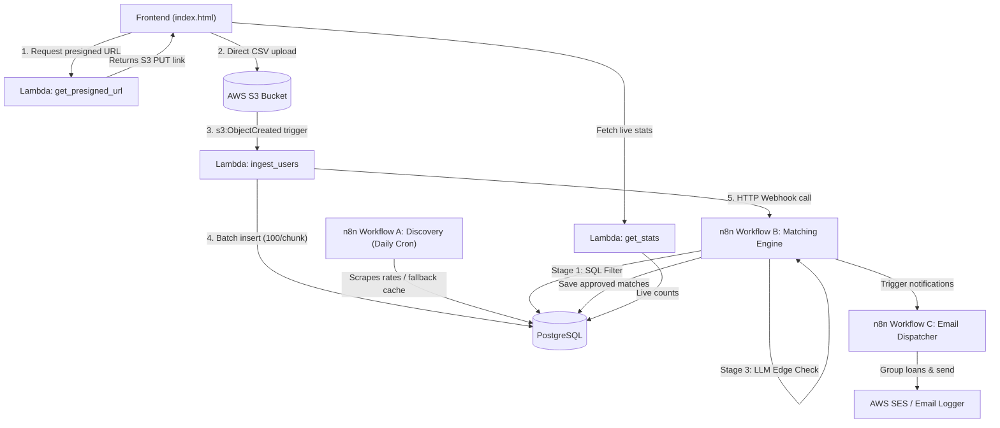

# Automated Loan Discovery & Smart Matcher

A serverless, event-driven system that ingests user profiles from CSV, scrapes public loan products, matches applicants to loans using an optimized 3-stage filter, and prepares consolidated email notifications.

Built as an engineering task solution using **AWS (S3, Lambda, SES)**, **PostgreSQL**, **n8n**, and **Python**.

---

## The Problem & How I Approached It

When I was given this task, the core requirement was straightforward:
> *Take a CSV of users &rarr; scrape loan products &rarr; match them smartly &rarr; email the users.*

Instead of building a standard toy script (like a basic Flask endpoint that crashes on large files or blindly loops an LLM on every record), I sat down and thought through the real production edge-cases:

1. **How to handle large CSV files without timeouts?**  
   If a user uploads a CSV with 5,000+ rows, sending it directly through API Gateway or a web server will hit a 29-second timeout or exhaust container memory.  
   **My Solution:** Use **S3 Pre-signed URLs**. The frontend asks Lambda for a temporary authenticated URL and uploads the CSV directly to S3. S3 then triggers the backend worker asynchronously.

2. **How to prevent database overhead & duplicate entries?**  
   Inserting row-by-row in a Python loop creates thousands of network round-trips. Also, what if someone uploads the same file twice?  
   **My Solution:** The ingestion Lambda reads the CSV and inserts in **batches of 100** using `ON CONFLICT (email) DO NOTHING`. It runs fast and is completely idempotent.

3. **What if the public loan site blocks the scraper?**  
   Bank websites frequently change structure or block scrapers with 403 Forbidden errors. If the scraper breaks, the entire matching engine has no loans to work with.  
   **My Solution:** Workflow A runs on a daily schedule and includes an **IF fallback node**. If the HTTP scrape fails or times out, it seamlessly loads verified products from a local backup cache (`data/backup_loans.json`). The database is always populated.

4. **The Cost Trap: How to do "Smart Matching" without burning LLM tokens?**  
   If you have 1,000 users and 10 loan products, that is **10,000 pairs**. Blindly passing 10,000 combinations to Gemini or GPT would cost real money, trigger rate-limits, and take 15+ minutes.  
   **My Solution:** A **3-Stage Filtering Pipeline** (detailed below) that cuts out 95%+ of combinations using free database queries before ever touching an LLM.

5. **Notification spam:**  
   If a user qualifies for 4 different loans, sending 4 separate emails feels like spam.  
   **My Solution:** Workflow C groups all qualified loans per applicant into a single clean summary email, and filters test recipients so no random emails from the CSV receive demo messages.

---

## Architecture Flow



---

## The 3-Stage Matching Optimization (How It Works)

The matching engine in **Workflow B** does not treat every applicant equally. It uses a progressive filter:

```
[10,000 Applicant-Loan Combinations]
                │
                ▼
  [ Stage 1: SQL Filter (Income & Credit) ]   ── Free & Instant (<10ms)
                │ (Cuts ~90% of unqualified pairs)
                ▼
  [ Stage 2: Employment String Match ]         ── Free Rule-based IF Node
       │                               │
  (Matches e.g. "Salaried")      (Ambiguous e.g. "Freelancer" vs "Self-Employed")
       │                               │
       ▼                               ▼
[Directly Approved]            [ Stage 3: Gemini LLM Evaluation ] ── Only ~50 calls!
       │                               │
       └───────────────┬───────────────┘
                       │
                       ▼
              [ Save to matches ]
```

* **Stage 1 (SQL - Fast & Free):**  
  `SELECT * FROM users u CROSS JOIN loan_products lp WHERE u.monthly_income >= lp.min_income AND u.credit_score >= lp.min_credit_score;`  
  This single query immediately drops anyone who simply doesn't earn enough or has poor credit.
* **Stage 2 (n8n IF Node - Free):**  
  Checks if `employment_status` is explicitly listed in `employment_types`. Exact matches bypass the LLM completely.
* **Stage 3 (LLM - Used sparingly):**  
  For the small leftover fraction of ambiguous edge cases, we call Gemini with a single prompt:  
  *"User is {employment_status} with income {income}. Loan requires {employment_types}. Is he likely eligible? Reply YES/NO."*
* **Result:** **95%+ reduction in API calls** while maintaining intelligent decision-making for tricky profiles.

---

## Project Structure

```text
├── lambda/
│   ├── get_presigned_url.py  # Generates S3 PUT presigned URL for direct browser uploads
│   ├── ingest_users.py       # S3 event worker: batches CSV parsing (100 rows) & notifies n8n
│   └── get_stats.py          # Queries Postgres counts for dashboard cards
├── n8n-workflows/
│   ├── A_discovery.json      # Daily scraper with local JSON fallback
│   ├── B_matching.json       # 3-Stage matching pipeline (SQL -> IF -> LLM)
│   └── C_notify.json         # Match aggregator & SES notification dispatcher
├── data/
│   ├── sample_users.csv      # Sample applicant dataset with test emails
│   └── backup_loans.json     # Offline backup cache of loan products
├── schema.sql                # PostgreSQL DDL tables (users, loan_products, matches)
├── serverless.yml            # Serverless framework definition (S3, Lambdas, SES, RDS)
├── docker-compose.yml        # Local development environment (PostgreSQL + n8n)
├── index.html                # Frontend dashboard with live cards, S3 upload & email preview
├── local_server.py           # Local runner with CORS & Docker database integration
├── .env.example              # Environment variables template
└── README.md                 # Project documentation
```

---

## How to Run & Test Locally

### 1. Start the Database and n8n

Ensure Docker is running, then execute:

```powershell
docker compose up -d
```

* **PostgreSQL** runs on `localhost:5432` (initializes tables from `schema.sql` automatically).
* **n8n** runs on `http://localhost:5678`.

### 2. Start the Frontend & Dev Server

Open PowerShell in the project directory and run:

```powershell
python local_server.py
```

Open your browser to: **`http://localhost:8000`**

### 3. Test the Whole Flow

1. On the dashboard (`http://localhost:8000`), view the live counters (`Total Users`, `Total Loans`, `Total Matches`).
2. Click **"📁 Click here to select a CSV file"** and choose `data/sample_users.csv`.
3. Click **"Upload to S3"**:
   - The browser requests a pre-signed URL.
   - The CSV uploads directly.
   - The ingestion worker parses the file in batches of 100 into PostgreSQL.
   - The n8n `/new-users` webhook is triggered.
   - The 3-stage matching pipeline evaluates applicants and stores matches.
   - The notification dispatcher groups loan offers by applicant.
4. Refresh stats to see the updated counts, or scroll down to section **3** on the dashboard to preview the generated SES notification emails!

---

## Key Technical Decisions Summary

| Area | Traditional Approach | What I Built |
|---|---|---|
| **File Upload** | Direct `POST` to backend (fails on large files) | Pre-signed S3 URL for direct client-to-storage upload |
| **Ingestion** | Row-by-row `INSERT` loop | Batched chunks of 100 with `ON CONFLICT DO NOTHING` |
| **Scraper** | Synchronous scraping on user request | Independent daily cron with local JSON fallback cache |
| **Matching** | Send all pairs to an LLM (slow & expensive) | 3-Stage Filter: SQL &rarr; String Match &rarr; LLM edge cases |
| **Notifications** | Send 1 email per loan (inbox spam) | Group all qualified offers into 1 email per applicant |
